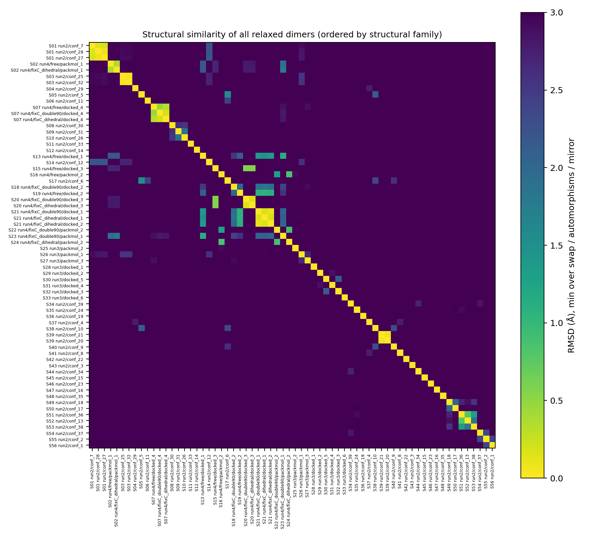
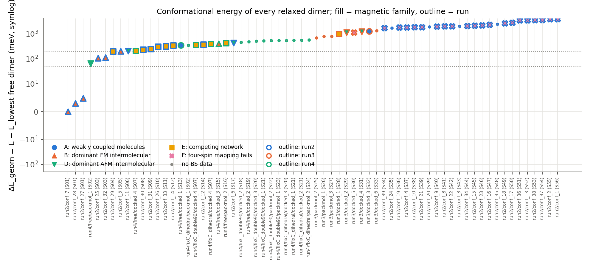
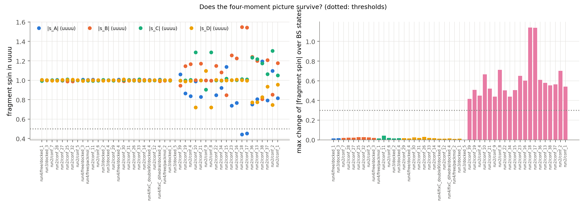
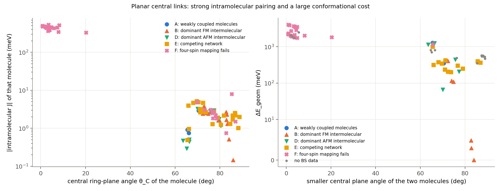
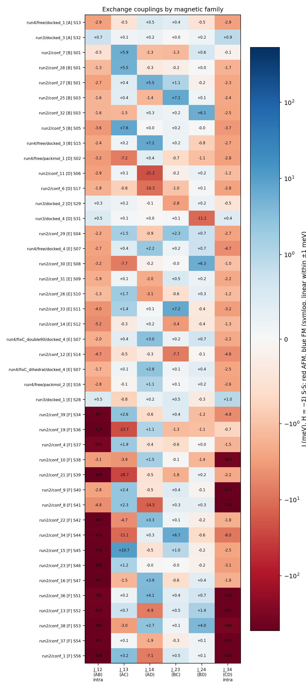
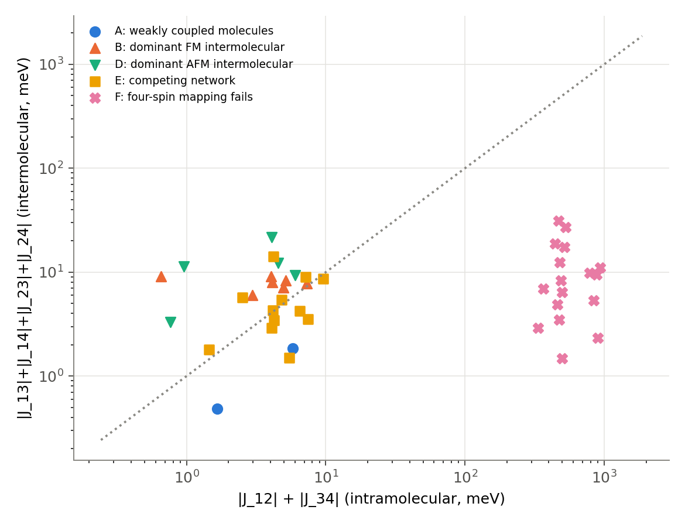
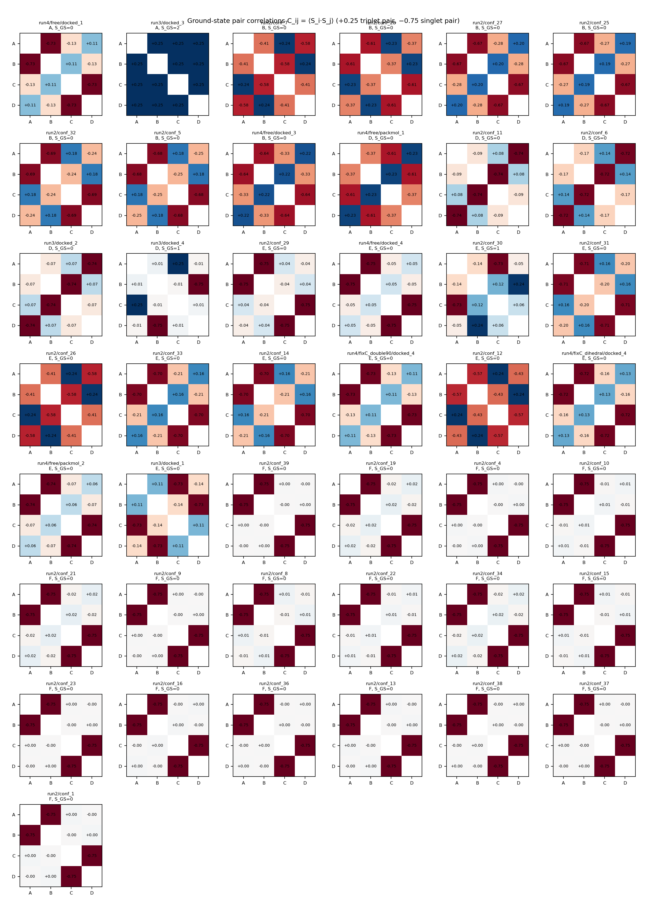
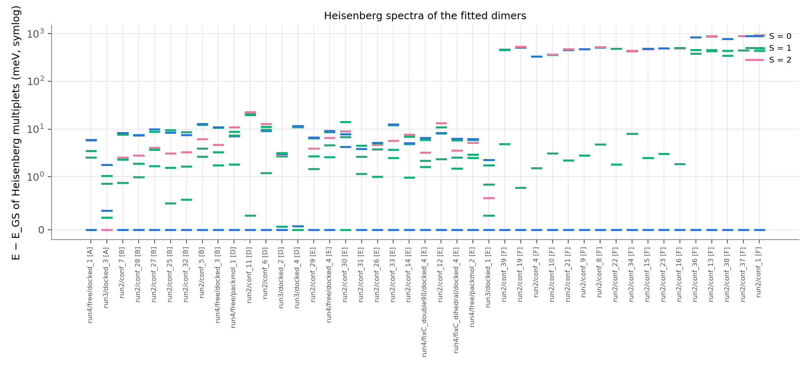
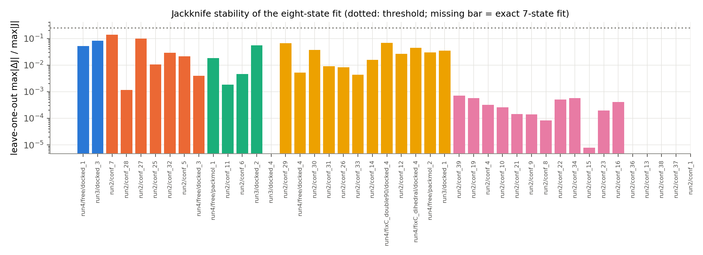
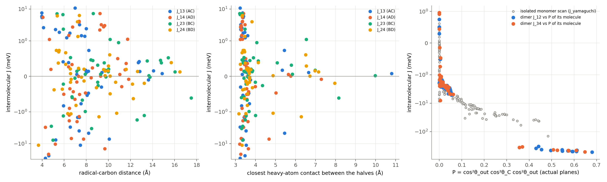

# Structural and magnetic families of the four-radical dimers (run2 + run3 + run4)

Generated by `visualisation/analyze_dimer_families.py`. Data: [dimer_families.csv](dimer_families.csv) (one row per relaxed dimer, all descriptors), [rmsd_matrix.csv](rmsd_matrix.csv), [heisenberg_spectra.csv](heisenberg_spectra.csv).

Convention: H = −Σ J_ij S_i·S_j, J > 0 FM, J < 0 AFM; sites 1–4 = radicals A, B (molecule 1), C, D (molecule 2); J_12 and J_34 intramolecular, the other four intermolecular. ΔE_geom is the R2SCAN-3C relaxation energy relative to the lowest unconstrained converged dimer (run2/conf_7); it is never mixed with broken-symmetry splittings.

## Coverage

| run | relaxed dimers | converged | relaxation | with fitted J |
|---|---|---|---|---|
| run2 | 39 | 30 | free | 25 |
| run3 | 9 | 7 | constrained torsions | 4 |
| run4 | 18 | 16 | constrained torsions, free | 0 |

run4 has no broken-symmetry results yet, so it enters the structural part only; run3 and the run4 fixC sets were relaxed with constrained torsions and are not free minima (kept, but flagged).

## 1. Which relaxations are the same minimum?

RMSD after optimal superposition, minimised over molecule swap, the 8 graph automorphisms of each monomer and mirror images; complete linkage cut at 0.5 Å. **66 relaxed dimers form 58 structural families; 5 of them contain more than one relaxation.**

Pairwise RMSD: median 4.80 Å, 11 pairs below 0.5 Å, 18 below 1 Å; 0 of the sub-cut pairs are related by a mirror image.

Families with more than one member (the run is metadata):

| struct_family | n | runs | E_min | E_max | members |
|---|---|---|---|---|---|
| S01 | 3 | run2 | 0.0 | 4.8 | run2/conf_7, run2/conf_27, run2/conf_28 |
| S02 | 2 | run4 | 66.4 | 350.9 | run4/fixC_dihedral/packmol_1, run4/free/packmol_1 |
| S07 | 3 | run4 | 208.1 | 396.5 | run4/fixC_dihedral/docked_4, run4/fixC_double90/docked_4, run4/free/docked_4 |
| S20 | 2 | run4 | 521.5 | 548.9 | run4/fixC_dihedral/docked_3, run4/fixC_double90/docked_3 |
| S21 | 3 | run4 | 526.7 | 568.8 | run4/fixC_dihedral/docked_1, run4/fixC_dihedral/docked_2, run4/fixC_double90/docked_1 |

**Same structure, same couplings?** The radical labels A–D follow each dimer's atom numbering, so two copies of one structure can carry permuted labels. Using the atom correspondence of the optimal superposition, the couplings of every member are re-expressed in the labels of the family's lowest-energy member (`Jal_*` columns in the CSV):

| struct_family | key | dE_geom_meV | label_map_to_rep | Jal_12_meV | Jal_13_meV | Jal_14_meV | Jal_23_meV | Jal_24_meV | Jal_34_meV | dominant_radicals |
|---|---|---|---|---|---|---|---|---|---|---|
| S01 | run2/conf_7 | 0.0 | A->A B->B C->C D->D | -0.51 | +5.91 | -1.27 | -1.35 | +0.61 | -0.15 | AC |
| S01 | run2/conf_28 | 3.0 | A->A B->B C->C D->D | -1.31 | +5.45 | -0.35 | -0.22 | +0.01 | -1.66 | AC |
| S01 | run2/conf_27 | 4.8 | A->D B->C C->A D->B | -2.29 | +5.47 | -0.16 | +0.41 | +1.11 | -2.69 | AD |

- S01: after relabelling, the dominant pair is AC in every member; largest coupling difference between members 2.54 meV.

A different raw dominant pair (e.g. J_AC in one member, J_AD in another) can therefore be a labelling effect, not a different contact topology. Pair names are only comparable across dimers of one structural family.

## 2–3. Structural descriptors and conformational energy

Energy classes: low < 50 meV ≤ intermediate < 200 meV ≤ high (gas-phase R2SCAN-3C; no Boltzmann weights, since a junction can trap any of these).

| key | struct_family | relaxation | converged | dE_geom_meV | energy_class | theta_out_A | theta_out_B | theta_C_M1 | theta_out_C | theta_out_D | theta_C_M2 | centre_distance_A | mol_plane_angle | slip_A | min_CC_A | mag_family |
|---|---|---|---|---|---|---|---|---|---|---|---|---|---|---|---|---|
| run2/conf_7 | S01 | free | True | 0.0 | low | 34.6 | 40.0 | 84.0 | 35.9 | 38.4 | 85.9 | 5.7 | 44.6 | 1.2 | 3.4 | B: dominant FM intermolecular |
| run2/conf_28 | S01 | free | True | 3.0 | low | 34.1 | 40.4 | 83.4 | 37.5 | 38.6 | 82.9 | 5.7 | 42.2 | 1.2 | 3.4 | B: dominant FM intermolecular |
| run2/conf_27 | S01 | free | True | 4.8 | low | 35.9 | 38.9 | 82.8 | 40.8 | 34.1 | 83.1 | 5.8 | 42.2 | 1.4 | 3.3 | B: dominant FM intermolecular |
| run4/free/packmol_1 | S02 | free | True | 66.4 | intermediate | 35.2 | 38.6 | 70.1 | 34.8 | 36.2 | 71.9 | 7.5 | 57.8 | 5.4 | 3.3 | no BS data |
| run2/conf_29 | S03 | free | False | 131.2 | intermediate | 19.1 | 40.2 | 81.2 | 37.7 | 36.5 | 69.8 | 3.9 | 72.7 | 2.5 | 3.2 | no BS data |
| run2/conf_32 | S04 | free | False | 166.6 | intermediate | 42.9 | 38.3 | 80.6 | 40.8 | 32.0 | 79.2 | 6.6 | 48.1 | 1.6 | 3.3 | no BS data |
| run2/conf_5 | S05 | free | True | 206.1 | high | 33.6 | 34.9 | 72.7 | 33.8 | 34.9 | 73.1 | 5.2 | 80.1 | 4.8 | 3.4 | B: dominant FM intermolecular |
| run2/conf_11 | S06 | free | True | 206.7 | high | 32.8 | 34.3 | 77.4 | 36.7 | 47.7 | 80.5 | 6.5 | 49.0 | 3.9 | 3.3 | D: dominant AFM intermolecular |
| run4/free/docked_4 | S07 | free | True | 208.1 | high | 34.9 | 43.4 | 72.7 | 29.7 | 35.5 | 72.4 | 8.1 | 48.0 | 7.2 | 3.3 | no BS data |
| run2/conf_31 | S08 | free | True | 250.0 | high | 38.0 | 40.2 | 79.1 | 31.4 | 33.0 | 85.7 | 6.7 | 40.8 | 1.4 | 3.4 | E: competing network |
| run2/conf_26 | S09 | free | True | 303.1 | high | 61.6 | 42.6 | 76.7 | 41.0 | 46.6 | 80.4 | 5.8 | 14.7 | 1.8 | 3.4 | E: competing network |
| run2/conf_25 | S10 | free | False | 310.6 | high | 38.6 | 38.6 | 84.7 | 31.8 | 47.2 | 80.7 | 6.1 | 52.9 | 2.2 | 3.4 | no BS data |
| run2/conf_33 | S11 | free | True | 316.6 | high | 49.0 | 32.8 | 65.9 | 35.5 | 44.5 | 71.5 | 6.5 | 88.5 | 3.0 | 3.2 | E: competing network |
| run2/conf_14 | S12 | free | True | 345.7 | high | 36.6 | 33.5 | 69.7 | 41.5 | 36.6 | 84.6 | 7.2 | 38.6 | 5.0 | 3.3 | E: competing network |
| run4/free/docked_1 | S13 | free | True | 350.7 | high | 35.3 | 38.7 | 70.5 | 37.0 | 36.9 | 73.3 | 8.0 | 47.4 | 2.2 | 3.5 | no BS data |
| run4/fixC_dihedral/packmol_1 | S02 | constrained torsions | False | 350.9 | high | 36.3 | 33.4 | 85.5 | 37.0 | 36.3 | 86.2 | 7.8 | 59.3 | 5.7 | 3.3 | no BS data |
| run2/conf_30 | S14 | free | False | 357.2 | high | 52.3 | 39.4 | 70.8 | 50.2 | 32.8 | 82.6 | 5.8 | 55.8 | 2.1 | 3.3 | no BS data |
| run4/fixC_double90/docked_4 | S07 | constrained torsions | True | 363.8 | high | 36.5 | 41.0 | 88.7 | 31.4 | 32.2 | 86.9 | 8.2 | 53.5 | 7.5 | 3.3 | no BS data |
| run4/fixC_dihedral/docked_4 | S07 | constrained torsions | True | 396.5 | high | 36.6 | 40.7 | 85.7 | 31.8 | 32.9 | 86.8 | 8.2 | 51.5 | 7.2 | 3.3 | no BS data |
| run4/free/docked_3 | S15 | free | True | 402.3 | high | 34.2 | 42.1 | 72.4 | 37.2 | 35.4 | 75.8 | 9.2 | 16.1 | 7.8 | 3.4 | no BS data |
| run4/free/packmol_2 | S16 | free | True | 424.0 | high | 35.8 | 44.7 | 77.3 | 40.2 | 36.6 | 71.2 | 8.3 | 61.6 | 6.5 | 3.3 | no BS data |
| run2/conf_6 | S17 | free | True | 443.3 | high | 24.9 | 40.4 | 79.7 | 35.6 | 36.9 | 75.7 | 5.3 | 77.3 | 3.7 | 3.2 | D: dominant AFM intermolecular |
| run4/fixC_double90/docked_2 | S18 | constrained torsions | False | 467.5 | high | 39.7 | 36.9 | 88.9 | 35.6 | 44.4 | 89.2 | 8.1 | 48.7 | 1.3 | 3.3 | no BS data |
| run4/free/docked_2 | S19 | free | True | 488.1 | high | 39.2 | 36.1 | 76.7 | 36.2 | 38.6 | 76.3 | 9.2 | 66.7 | 0.4 | 3.5 | no BS data |
| run4/fixC_double90/docked_3 | S20 | constrained torsions | True | 521.5 | high | 34.3 | 43.3 | 88.8 | 37.8 | 35.3 | 89.1 | 9.7 | 13.1 | 8.4 | 3.5 | no BS data |
| run4/fixC_double90/docked_1 | S21 | constrained torsions | True | 526.7 | high | 36.1 | 40.1 | 89.0 | 40.7 | 36.0 | 88.9 | 8.6 | 46.0 | 1.6 | 3.7 | no BS data |
| run4/fixC_double90/packmol_2 | S22 | constrained torsions | True | 541.1 | high | 36.7 | 41.3 | 89.6 | 36.2 | 37.1 | 87.5 | 8.7 | 89.0 | 7.3 | 3.5 | no BS data |
| run4/fixC_double90/packmol_1 | S23 | constrained torsions | True | 544.8 | high | 36.7 | 38.2 | 89.1 | 41.3 | 35.1 | 88.1 | 8.4 | 59.7 | 4.0 | 3.5 | no BS data |
| run4/fixC_dihedral/docked_3 | S20 | constrained torsions | True | 548.9 | high | 34.9 | 41.6 | 87.9 | 37.6 | 34.9 | 89.4 | 9.7 | 20.0 | 8.4 | 3.5 | no BS data |
| run4/fixC_dihedral/docked_1 | S21 | constrained torsions | True | 565.2 | high | 36.2 | 40.0 | 88.0 | 41.4 | 36.0 | 88.8 | 8.5 | 43.4 | 1.6 | 3.6 | no BS data |
| run4/fixC_dihedral/docked_2 | S21 | constrained torsions | True | 568.8 | high | 41.2 | 36.1 | 89.8 | 36.4 | 39.7 | 88.2 | 8.6 | 45.8 | 1.8 | 3.7 | no BS data |
| run4/fixC_dihedral/packmol_2 | S24 | constrained torsions | True | 578.8 | high | 37.6 | 38.9 | 88.8 | 39.8 | 35.6 | 87.4 | 8.8 | 76.6 | 7.4 | 3.4 | no BS data |
| run2/conf_12 | S25 | free | False | 637.1 | high | 48.8 | 32.5 | 68.8 | 25.6 | 41.0 | 70.2 | 6.8 | 68.6 | 3.4 | 3.4 | no BS data |
| run3/packmol_2 | S26 | constrained torsions | True | 705.8 | high | 84.1 | 40.3 | 65.0 | 86.2 | 41.3 | 65.9 | 7.2 | 47.4 | 4.3 | 3.3 | no BS data |
| run3/packmol_1 | S27 | constrained torsions | False | 807.9 | high | 83.3 | 39.5 | 67.1 | 88.2 | 42.4 | 66.5 | 6.8 | 32.7 | 1.8 | 3.4 | no BS data |
| run3/packmol_3 | S28 | constrained torsions | False | 810.8 | high | 89.9 | 41.2 | 65.7 | 81.8 | 39.9 | 64.6 | 7.6 | 44.5 | 5.5 | 3.4 | no BS data |
| run3/docked_1 | S29 | constrained torsions | True | 1000.9 | high | 89.9 | 41.7 | 65.5 | 89.0 | 41.4 | 66.2 | 8.8 | 74.0 | 8.0 | 3.3 | E: competing network |
| run3/docked_2 | S30 | constrained torsions | True | 1140.0 | high | 87.8 | 37.6 | 65.3 | 77.7 | 37.2 | 63.6 | 8.8 | 65.1 | 8.0 | 3.3 | D: dominant AFM intermolecular |
| run3/docked_5 | S31 | constrained torsions | True | 1154.8 | high | 81.5 | 40.0 | 65.6 | 89.1 | 40.5 | 66.1 | 8.7 | 81.2 | 2.8 | 3.3 | F: four-spin mapping fails |
| run3/docked_4 | S32 | constrained torsions | True | 1246.1 | high | 89.4 | 38.9 | 66.3 | 89.4 | 39.2 | 66.3 | 10.0 | 88.3 | 8.8 | 3.3 | D: dominant AFM intermolecular |
| run3/docked_3 | S33 | constrained torsions | True | 1287.0 | high | 88.9 | 41.2 | 66.2 | 89.2 | 40.9 | 65.5 | 10.0 | 72.1 | 4.4 | 3.3 | A: weakly coupled molecules |
| run3/docked_6 | S34 | constrained torsions | True | 1337.1 | high | 89.0 | 41.1 | 66.1 | 85.5 | 40.4 | 65.7 | 10.4 | 51.1 | 8.0 | 3.4 | no BS data |
| run2/conf_24 | S35 | free | False | 1623.8 | high | 28.3 | 34.3 | 2.9 | 42.7 | 36.6 | 71.2 | 5.0 | 26.1 | 1.7 | 3.3 | no BS data |
| run2/conf_39 | S36 | free | True | 1743.5 | high | 31.1 | 34.4 | 4.8 | 33.4 | 30.2 | 69.8 | 6.0 | 26.1 | 4.0 | 3.2 | F: four-spin mapping fails |
| run2/conf_19 | S37 | free | True | 1808.5 | high | 17.5 | 30.0 | 3.4 | 41.0 | 48.6 | 82.8 | 7.4 | 47.1 | 7.2 | 3.2 | F: four-spin mapping fails |
| run2/conf_4 | S38 | free | True | 1821.1 | high | 13.1 | 43.4 | 20.3 | 36.5 | 35.9 | 86.9 | 5.6 | 58.5 | 4.3 | 3.3 | F: four-spin mapping fails |
| run2/conf_10 | S39 | free | True | 1887.5 | high | 33.0 | 30.0 | 75.8 | 47.6 | 27.6 | 3.3 | 4.7 | 58.3 | 2.4 | 3.3 | F: four-spin mapping fails |
| run2/conf_21 | S40 | free | True | 1899.7 | high | 26.7 | 31.8 | 2.5 | 29.3 | 40.2 | 78.1 | 7.0 | 41.2 | 4.4 | 3.2 | F: four-spin mapping fails |
| run2/conf_20 | S41 | free | False | 1995.5 | high | 25.0 | 32.6 | 2.8 | 34.7 | 41.7 | 79.9 | 7.5 | 36.9 | 4.9 | 3.3 | no BS data |
| run2/conf_9 | S42 | free | True | 1996.6 | high | 33.0 | 36.8 | 77.2 | 27.6 | 31.1 | 1.9 | 5.4 | 10.3 | 1.2 | 3.3 | no BS data |
| run2/conf_8 | S43 | free | True | 2020.3 | high | 35.0 | 31.2 | 69.9 | 29.0 | 21.6 | 8.2 | 4.5 | 28.3 | 0.2 | 3.2 | F: four-spin mapping fails |
| run2/conf_22 | S44 | free | True | 2035.8 | high | 26.8 | 34.0 | 1.8 | 50.6 | 35.6 | 78.5 | 7.2 | 29.2 | 5.4 | 3.4 | F: four-spin mapping fails |
| run2/conf_3 | S45 | free | False | 2093.1 | high | 24.5 | 32.5 | 1.1 | 34.1 | 35.9 | 81.0 | 10.2 | 69.0 | 7.5 | 3.3 | no BS data |
| run2/conf_34 | S46 | free | True | 2121.4 | high | 28.1 | 32.9 | 3.7 | 29.0 | 25.2 | 85.3 | 6.2 | 16.0 | 4.2 | 3.2 | F: four-spin mapping fails |
| run2/conf_15 | S47 | free | True | 2181.7 | high | 30.0 | 29.1 | 0.9 | 35.2 | 56.1 | 76.6 | 8.0 | 62.7 | 4.4 | 3.2 | F: four-spin mapping fails |
| run2/conf_23 | S48 | free | True | 2245.8 | high | 20.8 | 33.3 | 0.8 | 35.1 | 37.4 | 73.2 | 8.5 | 11.4 | 4.6 | 3.5 | F: four-spin mapping fails |
| run2/conf_16 | S49 | free | True | 2335.5 | high | 23.3 | 33.0 | 1.0 | 48.4 | 33.7 | 76.9 | 10.8 | 57.1 | 7.3 | 3.3 | F: four-spin mapping fails |
| run2/conf_35 | S50 | free | False | 2589.4 | high | 23.0 | 34.2 | 4.2 | 28.3 | 34.3 | 87.6 | 8.5 | 86.0 | 7.5 | 3.3 | no BS data |
| run2/conf_18 | S51 | free | True | 2695.3 | high | 32.4 | 38.8 | 2.1 | 39.6 | 39.6 | 73.7 | 8.1 | 38.7 | 6.2 | 3.3 | F: four-spin mapping fails |
| run2/conf_17 | S52 | free | True | 2859.1 | high | 33.2 | 38.6 | 4.4 | 39.9 | 56.9 | 82.2 | 7.2 | 42.7 | 4.7 | 3.3 | F: four-spin mapping fails |
| run2/conf_36 | S53 | free | True | 3489.3 | high | 28.7 | 41.5 | 4.0 | 35.2 | 16.6 | 4.2 | 6.2 | 18.5 | 4.0 | 3.3 | F: four-spin mapping fails |
| run2/conf_13 | S54 | free | True | 3507.4 | high | 28.8 | 39.3 | 5.9 | 34.1 | 23.4 | 4.8 | 6.4 | 16.4 | 4.3 | 3.3 | F: four-spin mapping fails |
| run2/conf_38 | S55 | free | True | 3585.4 | high | 33.3 | 27.6 | 3.8 | 42.0 | 34.4 | 7.9 | 6.8 | 10.3 | 5.1 | 3.2 | F: four-spin mapping fails |
| run2/conf_37 | S56 | free | True | 3654.9 | high | 17.3 | 34.3 | 7.4 | 30.1 | 33.0 | 3.2 | 7.5 | 24.0 | 6.0 | 3.3 | F: four-spin mapping fails |
| run2/conf_2 | S57 | free | True | 3915.9 | high | 31.1 | 29.0 | 1.4 | 44.5 | 28.8 | 3.0 | 9.3 | 45.6 | 7.2 | 3.1 | F: four-spin mapping fails |
| run2/conf_1 | S58 | free | True | 3987.7 | high | 25.3 | 31.6 | 0.9 | 34.3 | 30.4 | 2.5 | 8.6 | 60.7 | 5.4 | 3.3 | F: four-spin mapping fails |

Full descriptors (signed outer/central dihedrals, P per molecule, radical-carbon distances d_rad_ij, closest contacts and C···C counts between radical halves) are in the CSV.

## 4. Does the four-moment picture survive?

Of 34 dimers with broken-symmetry data, **15 keep four stable local moments** (|s| ≥ 0.5 everywhere and |s| changing by ≤ 0.3 between BS states); the others are placed in family F rather than forced into a magnetic class.

| key | s_A_uuuu | s_B_uuuu | s_C_uuuu | s_D_uuuu | s_mean_uuuu | s_spread_uuuu | moment_spread_BS | min_moment_BS | moments_ok |
|---|---|---|---|---|---|---|---|---|---|
| run2/conf_7 | 1.00 | 1.00 | 1.00 | 1.00 | 1.00 | 0.01 | 0.02 | 0.99 | True |
| run2/conf_28 | 1.00 | 1.00 | 1.00 | 1.00 | 1.00 | 0.01 | 0.02 | 0.99 | True |
| run2/conf_27 | 1.00 | 1.00 | 1.00 | 1.00 | 1.00 | 0.01 | 0.02 | 0.99 | True |
| run2/conf_5 | 1.00 | 1.00 | 1.00 | 1.00 | 1.00 | 0.00 | 0.02 | 0.98 | True |
| run2/conf_11 | 1.01 | 1.00 | 0.99 | 1.00 | 1.00 | 0.01 | 0.04 | 0.97 | True |
| run2/conf_31 | 1.00 | 1.00 | 1.01 | 1.00 | 1.00 | 0.01 | 0.02 | 0.99 | True |
| run2/conf_26 | 1.01 | 1.00 | 1.00 | 1.00 | 1.00 | 0.01 | 0.03 | 0.98 | True |
| run2/conf_33 | 0.99 | 1.00 | 1.01 | 1.00 | 1.00 | 0.01 | 0.02 | 0.99 | True |
| run2/conf_14 | 1.00 | 1.00 | 1.00 | 1.00 | 1.00 | 0.01 | 0.02 | 0.99 | True |
| run2/conf_6 | 1.00 | 1.00 | 1.00 | 1.00 | 1.00 | 0.00 | 0.02 | 0.99 | True |
| run3/docked_1 | 1.00 | 1.00 | 1.00 | 1.00 | 1.00 | 0.00 | 0.01 | 0.99 | True |
| run3/docked_2 | 1.00 | 1.00 | 1.00 | 1.00 | 1.00 | 0.01 | 0.02 | 0.99 | True |
| run3/docked_5 |  |  |  |  |  |  | 0.00 | 0.98 | True |
| run3/docked_4 | 1.00 | 1.00 | 1.00 | 1.00 | 1.00 | 0.00 | 0.02 | 0.98 | True |
| run3/docked_3 | 1.00 | 1.00 | 1.00 | 1.00 | 1.00 | 0.00 | 0.02 | 0.98 | True |
| run2/conf_39 | 1.06 | 0.95 | 1.00 | 1.00 | 1.00 | 0.12 | 0.42 | 0.65 | False |
| run2/conf_19 | 0.87 | 1.15 | 1.00 | 0.99 | 1.00 | 0.28 | 0.51 | 0.61 | False |
| run2/conf_4 | 0.84 | 1.17 | 1.00 | 0.99 | 1.00 | 0.33 | 0.45 | 0.72 | False |
| run2/conf_10 | 0.99 | 1.00 | 1.29 | 0.72 | 1.00 | 0.57 | 0.66 | 0.62 | False |
| run2/conf_21 | 0.83 | 1.17 | 1.00 | 1.00 | 1.00 | 0.34 | 0.52 | 0.63 | False |
| run2/conf_8 |  |  |  |  |  |  | 0.68 | 0.59 | False |
| run2/conf_22 | 0.85 | 1.15 | 1.00 | 1.00 | 1.00 | 0.30 | 0.50 | 0.64 | False |
| run2/conf_34 | 0.92 | 1.08 | 1.00 | 1.00 | 1.00 | 0.16 | 0.44 | 0.67 | False |
| run2/conf_15 | 1.14 | 0.85 | 1.02 | 1.00 | 1.00 | 0.29 | 0.50 | 0.63 | False |
| run2/conf_23 | 0.74 | 1.26 | 1.00 | 1.00 | 1.00 | 0.52 | 0.65 | 0.60 | False |
| run2/conf_16 | 0.77 | 1.23 | 1.00 | 1.01 | 1.00 | 0.46 | 0.60 | 0.61 | False |
| run2/conf_18 | 0.44 | 1.55 | 1.01 | 1.00 | 1.00 | 1.10 | 1.14 | 0.39 | False |
| run2/conf_17 | 0.45 | 1.54 | 1.01 | 1.00 | 1.00 | 1.09 | 1.14 | 0.40 | False |
| run2/conf_36 | 0.75 | 1.24 | 1.23 | 0.77 | 1.00 | 0.49 | 0.61 | 0.62 | False |
| run2/conf_13 | 0.81 | 1.20 | 1.22 | 0.78 | 1.00 | 0.44 | 0.58 | 0.63 | False |
| run2/conf_38 | 1.20 | 0.81 | 1.17 | 0.83 | 1.00 | 0.39 | 0.55 | 0.64 | False |
| run2/conf_37 | 0.79 | 1.21 | 1.06 | 0.94 | 1.00 | 0.42 | 0.56 | 0.64 | False |
| run2/conf_2 | 1.10 | 0.85 | 1.30 | 0.75 | 1.00 | 0.56 | 0.70 | 0.60 | False |
| run2/conf_1 | 0.82 | 1.18 | 1.05 | 0.96 | 1.00 | 0.36 | 0.54 | 0.62 | False |

The radical halves cover the whole molecule (terminal ring + adjacent backbone half), so a separate 'backbone leakage' cannot be defined with this partition; s_spread and the BS spread measure it indirectly.

**What the failed dimers have in common.** 15 of 15 fitted family-F dimers contain a molecule with an almost planar central link (θ_C < 25°; median 3.3°), against 0 of 14 dimers in A–E (median 74.2°). Those molecules have |J_intra| of 332–529 meV and the dimers lie 1.7–4.0 eV above the lowest dimer: a planar central link makes the molecule strongly paired (quinoidal / closed-shell character), the radical spin is no longer split evenly over the two halves, and the four-spin mapping breaks down. These are high-energy conformers carried over from the starting structures, not low-lying dimer motifs.

## 5–6. Exchange couplings and magnetic families

Rules, applied in order: **F** fewer than 7 valid configurations, unstable moments, or leave-one-out max|ΔJ|/max|J| > 0.25; **A** max|J_inter| < 0.3·max|J_intra| (or an intramolecular pair dominates); **B / D** one intermolecular pair dominates (R_dom ≥ 0.4 and |J1/J2| ≥ 2.0), FM / AFM (the pair name depends on the atom labelling, see section 1); **E** everything else.

| magnetic family | dimers |
|---|---|
| A: weakly coupled molecules | 1 |
| B: dominant FM intermolecular | 4 |
| D: dominant AFM intermolecular | 4 |
| E: competing network | 5 |
| F: four-spin mapping fails | 20 |
| no BS data | 32 |

| key | mag_family | mag_reason | dE_geom_meV | J_12_meV | J_13_meV | J_14_meV | J_23_meV | J_24_meV | J_34_meV | R_dom | dominant_radicals | J1_over_J2 | rms_residual_meV | max_rel_dJ |
|---|---|---|---|---|---|---|---|---|---|---|---|---|---|---|
| run3/docked_3 | A: weakly coupled molecules | max|J_inter| < 0.3 max|J_intra| | 1287.0 | +0.75 | +0.11 | +0.20 | +0.02 | +0.16 | +0.91 | 0.43 | CD | 1.2 | 0.019 | 0.083 |
| run2/conf_7 | B: dominant FM intermolecular | J_13 (AC) dominates | 0.0 | -0.51 | +5.91 | -1.27 | -1.35 | +0.61 | -0.15 | 0.60 | AC | 4.4 | 0.208 | 0.140 |
| run2/conf_28 | B: dominant FM intermolecular | J_13 (AC) dominates | 3.0 | -1.31 | +5.45 | -0.35 | -0.22 | +0.01 | -1.66 | 0.61 | AC | 3.3 | 0.002 | 0.001 |
| run2/conf_27 | B: dominant FM intermolecular | J_14 (AD) dominates | 4.8 | -2.69 | +0.41 | +5.47 | +1.11 | -0.16 | -2.29 | 0.45 | AD | 2.0 | 0.136 | 0.099 |
| run2/conf_5 | B: dominant FM intermolecular | J_13 (AC) dominates | 206.1 | -3.60 | +7.60 | +0.00 | +0.20 | -0.02 | -3.67 | 0.50 | AC | 2.1 | 0.041 | 0.021 |
| run2/conf_11 | D: dominant AFM intermolecular | J_14 (AD) dominates | 206.7 | -2.94 | +0.12 | -21.24 | -0.16 | +0.23 | -1.15 | 0.82 | AD | 7.2 | 0.010 | 0.002 |
| run2/conf_6 | D: dominant AFM intermolecular | J_14 (AD) dominates | 443.3 | -1.76 | -0.83 | -10.30 | -0.99 | +0.08 | -2.77 | 0.62 | AD | 3.7 | 0.012 | 0.005 |
| run3/docked_2 | D: dominant AFM intermolecular | J_23 (BC) dominates | 1140.0 | +0.29 | +0.17 | -0.08 | -2.83 | +0.21 | -0.47 | 0.70 | BC | 6.0 | 0.039 | 0.054 |
| run3/docked_4 | D: dominant AFM intermolecular | J_24 (BD) dominates | 1246.1 | +0.51 | +0.08 | +0.01 | +0.06 | -11.15 | +0.45 | 0.91 | BD | 22.0 | 0.000 |  |
| run2/conf_31 | E: competing network | no single dominant pair | 250.0 | -1.90 | +0.14 | -2.03 | +0.53 | +0.19 | -2.17 | 0.31 | CD | 1.1 | 0.005 | 0.009 |
| run2/conf_26 | E: competing network | no single dominant pair | 303.1 | -1.29 | +1.75 | -3.07 | -0.58 | +0.29 | -1.23 | 0.37 | AD | 1.8 | 0.006 | 0.008 |
| run2/conf_33 | E: competing network | no single dominant pair | 316.6 | -3.97 | +1.40 | +0.06 | +7.19 | -0.36 | -3.16 | 0.45 | BC | 1.8 | 0.008 | 0.004 |
| run2/conf_14 | E: competing network | no single dominant pair | 345.7 | -5.17 | -0.30 | +0.19 | -3.37 | -0.38 | -1.31 | 0.48 | AB | 1.5 | 0.020 | 0.016 |
| run3/docked_1 | E: competing network | no single dominant pair | 1000.9 | +0.49 | -0.77 | +0.24 | +0.46 | -0.32 | +0.96 | 0.30 | CD | 1.2 | 0.008 | 0.035 |
| run3/docked_5 | F: four-spin mapping fails | fewer than 7 valid configurations | 1154.8 |  |  |  |  |  |  |  |  |  |  |  |
| run2/conf_39 | F: four-spin mapping fails | fragment moments unstable between BS states | 1743.5 | -457.43 | +2.61 | -0.65 | +0.44 | -1.16 | -4.91 | 0.98 | AB | 93.1 | 0.082 | 0.001 |
| run2/conf_19 | F: four-spin mapping fails | fragment moments unstable between BS states | 1808.5 | -528.83 | -23.66 | +1.12 | -1.31 | -1.10 | -0.75 | 0.95 | AB | 22.4 | 0.076 | 0.001 |
| run2/conf_4 | F: four-spin mapping fails | fragment moments unstable between BS states | 1821.1 | -332.35 | +1.86 | -0.43 | -0.60 | +0.02 | -1.51 | 0.99 | AB | 178.3 | 0.027 | 0.000 |
| run2/conf_10 | F: four-spin mapping fails | fragment moments unstable between BS states | 1887.5 | -3.08 | -3.94 | +1.50 | -0.05 | -1.43 | -363.36 | 0.97 | CD | 92.3 | 0.024 | 0.000 |
| run2/conf_21 | F: four-spin mapping fails | fragment moments unstable between BS states | 1899.7 | -469.39 | -28.66 | -0.51 | -1.79 | +0.20 | -2.23 | 0.93 | AB | 16.4 | 0.017 | 0.000 |
| run2/conf_8 | F: four-spin mapping fails | fewer than 7 valid configurations | 2020.3 |  |  |  |  |  |  |  |  |  |  |  |
| run2/conf_22 | F: four-spin mapping fails | fragment moments unstable between BS states | 2035.8 | -485.45 | -4.69 | +3.25 | +0.14 | -0.22 | -1.79 | 0.98 | AB | 103.5 | 0.061 | 0.001 |
| run2/conf_34 | F: four-spin mapping fails | fragment moments unstable between BS states | 2121.4 | -434.11 | -11.12 | +0.33 | +6.68 | -0.63 | -8.01 | 0.94 | AB | 39.0 | 0.063 | 0.001 |
| run2/conf_15 | F: four-spin mapping fails | fragment moments unstable between BS states | 2181.7 | -475.57 | +10.73 | -0.50 | +0.95 | -0.20 | -2.50 | 0.97 | AB | 44.3 | 0.001 | 0.000 |
| run2/conf_23 | F: four-spin mapping fails | fragment moments unstable between BS states | 2245.8 | -495.39 | +1.25 | -0.04 | -0.02 | -0.16 | -3.06 | 0.99 | AB | 162.1 | 0.024 | 0.000 |
| run2/conf_16 | F: four-spin mapping fails | fragment moments unstable between BS states | 2335.5 | -497.02 | -1.49 | +3.94 | -0.61 | +0.39 | -1.84 | 0.98 | AB | 126.2 | 0.052 | 0.000 |
| run2/conf_18 | F: four-spin mapping fails | fewer than 7 valid configurations | 2695.3 |  |  |  |  |  |  |  |  |  |  |  |
| run2/conf_17 | F: four-spin mapping fails | fewer than 7 valid configurations | 2859.1 |  |  |  |  |  |  |  |  |  |  |  |
| run2/conf_36 | F: four-spin mapping fails | fragment moments unstable between BS states | 3489.3 | -384.66 | +0.17 | +4.10 | +0.38 | +0.67 | -454.47 | 0.54 | CD | 1.2 | 0.000 |  |
| run2/conf_13 | F: four-spin mapping fails | fragment moments unstable between BS states | 3507.4 | -429.98 | +0.74 | -6.88 | +0.46 | +1.37 | -454.93 | 0.51 | CD | 1.1 | 0.000 |  |
| run2/conf_38 | F: four-spin mapping fails | fragment moments unstable between BS states | 3585.4 | -440.26 | -3.02 | +2.72 | +0.13 | +3.98 | -343.74 | 0.55 | AB | 1.3 | 0.000 |  |
| run2/conf_37 | F: four-spin mapping fails | fragment moments unstable between BS states | 3654.9 | -451.42 | +0.06 | -1.90 | -0.26 | +0.13 | -449.80 | 0.50 | AB | 1.0 | 0.000 |  |
| run2/conf_2 | F: four-spin mapping fails | fewer than 7 valid configurations | 3915.9 |  |  |  |  |  |  |  |  |  |  |  |
| run2/conf_1 | F: four-spin mapping fails | fragment moments unstable between BS states | 3987.7 | -497.81 | +3.25 | -7.12 | +0.52 | +0.14 | -438.13 | 0.53 | AB | 1.1 | 0.000 |  |

## 7. Heisenberg spectra, pair correlations and composite spins

16×16 diagonalisation of the fitted Hamiltonian. C_ij = ⟨S_i·S_j⟩ in the ground state (averaged over a degenerate ground multiplet): +0.25 = triplet pair, −0.75 = singlet pair. S_ij^eff from ⟨(S_i+S_j)²⟩ = 3/2 + 2C_ij = S(S+1). S_AB^eff and S_CD^eff ≈ 1 mean each molecule still behaves as a triplet diradical; ≈ 0 means it is internally paired.

| key | mag_family | S_GS | Delta1_meV | S1 | Delta2_meV | S2 | Seff_12 | Seff_34 | C_13 | C_14 | C_23 | C_24 |
|---|---|---|---|---|---|---|---|---|---|---|---|---|
| run3/docked_3 | A: weakly coupled molecules | 2 | 0.232 | 1 | 0.364 | 0 | 1.00 | 1.00 | +0.25 | +0.25 | +0.25 | +0.25 |
| run2/conf_7 | B: dominant FM intermolecular | 0 | 0.889 | 1 | 2.3 | 1 | 0.47 | 0.47 | +0.24 | -0.58 | -0.58 | +0.24 |
| run2/conf_28 | B: dominant FM intermolecular | 0 | 0.997 | 1 | 1.9 | 1 | 0.23 | 0.23 | +0.23 | -0.37 | -0.37 | +0.23 |
| run2/conf_27 | B: dominant FM intermolecular | 0 | 1.67 | 1 | 3.7 | 1 | 0.14 | 0.14 | -0.28 | +0.20 | +0.20 | -0.28 |
| run2/conf_5 | B: dominant FM intermolecular | 0 | 2.63 | 1 | 3.96 | 1 | 0.12 | 0.12 | +0.18 | -0.25 | -0.25 | +0.18 |
| run2/conf_11 | D: dominant AFM intermolecular | 0 | 0.268 | 1 | 19.9 | 0 | 0.75 | 0.75 | +0.08 | -0.74 | -0.74 | +0.08 |
| run2/conf_6 | D: dominant AFM intermolecular | 0 | 1.2 | 1 | 9.25 | 0 | 0.69 | 0.69 | +0.14 | -0.72 | -0.72 | +0.14 |
| run3/docked_2 | D: dominant AFM intermolecular | 0 | 0.0618 | 1 | 2.68 | 1 | 0.77 | 0.77 | +0.07 | -0.74 | -0.74 | +0.07 |
| run3/docked_4 | D: dominant AFM intermolecular | 1 | 0.0687 | 0 | 10.9 | 2 | 0.83 | 0.83 | +0.25 | -0.01 | -0.01 | -0.75 |
| run2/conf_31 | E: competing network | 0 | 1.15 | 1 | 2.67 | 1 | 0.08 | 0.08 | +0.16 | -0.20 | -0.20 | +0.16 |
| run2/conf_26 | E: competing network | 0 | 1.02 | 1 | 3.76 | 1 | 0.46 | 0.46 | +0.24 | -0.58 | -0.58 | +0.24 |
| run2/conf_33 | E: competing network | 0 | 2.51 | 1 | 3.67 | 1 | 0.09 | 0.09 | -0.21 | +0.16 | +0.16 | -0.21 |
| run2/conf_14 | E: competing network | 0 | 0.988 | 1 | 4.85 | 1 | 0.09 | 0.09 | +0.16 | -0.21 | -0.21 | +0.16 |
| run3/docked_1 | E: competing network | 0 | 0.271 | 1 | 0.602 | 2 | 0.91 | 0.91 | -0.73 | -0.14 | -0.14 | -0.73 |
| run2/conf_39 | F: four-spin mapping fails | 0 | 4.91 | 1 | 457 | 1 | 0.00 | 0.00 | +0.00 | -0.00 | -0.00 | +0.00 |
| run2/conf_19 | F: four-spin mapping fails | 0 | 0.793 | 1 | 517 | 1 | 0.00 | 0.00 | -0.02 | +0.02 | +0.02 | -0.02 |
| run2/conf_4 | F: four-spin mapping fails | 0 | 1.52 | 1 | 332 | 1 | 0.00 | 0.00 | +0.00 | -0.00 | -0.00 | +0.00 |
| run2/conf_10 | F: four-spin mapping fails | 0 | 3.09 | 1 | 363 | 1 | 0.00 | 0.00 | -0.01 | +0.01 | +0.01 | -0.01 |
| run2/conf_21 | F: four-spin mapping fails | 0 | 2.21 | 1 | 456 | 1 | 0.00 | 0.00 | -0.02 | +0.02 | +0.02 | -0.02 |
| run2/conf_22 | F: four-spin mapping fails | 0 | 1.81 | 1 | 483 | 1 | 0.00 | 0.00 | -0.01 | +0.01 | +0.01 | -0.01 |
| run2/conf_34 | F: four-spin mapping fails | 0 | 8.03 | 1 | 434 | 1 | 0.00 | 0.00 | -0.02 | +0.02 | +0.02 | -0.02 |
| run2/conf_15 | F: four-spin mapping fails | 0 | 2.5 | 1 | 473 | 1 | 0.00 | 0.00 | +0.01 | -0.01 | -0.01 | +0.01 |
| run2/conf_23 | F: four-spin mapping fails | 0 | 3.06 | 1 | 495 | 1 | 0.00 | 0.00 | +0.00 | -0.00 | -0.00 | +0.00 |
| run2/conf_16 | F: four-spin mapping fails | 0 | 1.84 | 1 | 496 | 1 | 0.00 | 0.00 | -0.00 | +0.00 | +0.00 | -0.00 |
| run2/conf_36 | F: four-spin mapping fails | 0 | 385 | 1 | 454 | 1 | 0.00 | 0.00 | -0.00 | +0.00 | +0.00 | -0.00 |
| run2/conf_13 | F: four-spin mapping fails | 0 | 430 | 1 | 455 | 1 | 0.00 | 0.00 | +0.00 | -0.00 | -0.00 | +0.00 |
| run2/conf_38 | F: four-spin mapping fails | 0 | 344 | 1 | 440 | 1 | 0.00 | 0.00 | -0.00 | +0.00 | +0.00 | -0.00 |
| run2/conf_37 | F: four-spin mapping fails | 0 | 450 | 1 | 452 | 1 | 0.00 | 0.00 | +0.00 | -0.00 | -0.00 | +0.00 |
| run2/conf_1 | F: four-spin mapping fails | 0 | 438 | 1 | 498 | 1 | 0.00 | 0.00 | +0.00 | -0.00 | -0.00 | +0.00 |

**Two S = 1 molecules or four S = ½ radicals?** (families A–E only, F excluded) In 3 of 14 fitted dimers both molecules keep S_eff > 0.8 in the ground state (two interacting triplet diradicals); in 6 at least one molecule has S_eff < 0.3, although its |J_intra| is at most 5.2 meV: this is not pairing inside the molecule but the radicals being bound into intermolecular pairs (see C_13, C_14, C_23, C_24); the rest are intermediate. For the low-energy dimers the four-S = ½ picture, reorganised by the intermolecular contacts, describes the ground state better than two S = 1 molecules.

## Fit robustness (jackknife, condition number)

Eight states for seven parameters leave one redundant equation. Leave-one-out refits (each an exact 7-state solve): max|ΔJ|/max|J| median 0.002, max 0.140 (0 above 0.25). Condition number of the 8×7 design matrix 4.00 (well conditioned); leave-one-out matrices up to 9.98. Because the single redundancy is the four-spin term, |ΔJ| on removing a state is set by the fit residual; small residual and small ΔJ are therefore one test, not two.

## 8. Geometry versus magnetism

- |J_13| (AC) vs radical-carbon distance: Spearman ρ = -0.63; vs closest contact of the two halves: ρ = -0.42 (n = 29).
- |J_14| (AD) vs radical-carbon distance: Spearman ρ = -0.46; vs closest contact of the two halves: ρ = -0.62 (n = 29).
- |J_23| (BC) vs radical-carbon distance: Spearman ρ = -0.29; vs closest contact of the two halves: ρ = -0.36 (n = 29).
- |J_24| (BD) vs radical-carbon distance: Spearman ρ = -0.31; vs closest contact of the two halves: ρ = -0.38 (n = 29).
- In 8 of 8 dimers with one dominant intermolecular pair, that pair is also the pair of radical halves in closest contact.
- **Intramolecular J vs the isolated-monomer relation J(P):** for the 28 molecules of dimers in A–E (P ≤ 0.05) the dimer J_12 / J_34 lie on the monomer scan, median |J_dimer − J_monomer(P)| = 0.70 meV (monomer value = median of scan points within ΔP = 0.01): the intermolecular contact does not change the intramolecular coupling much. The planar-central-link molecules of family F (P = 0.35–0.7) are far more strongly coupled than any monomer-scan point, consistent with the breakdown in section 4.

## 9. Run reproducibility and structural × magnetic cross-table

| magnetic family | run2 | run3 | run4 | total |
|---|---|---|---|---|
| A: weakly coupled molecules | 0 | 1 | 0 | 1 |
| B: dominant FM intermolecular | 4 | 0 | 0 | 4 |
| D: dominant AFM intermolecular | 2 | 2 | 0 | 4 |
| E: competing network | 4 | 1 | 0 | 5 |
| F: four-spin mapping fails | 19 | 1 | 0 | 20 |
| no BS data | 10 | 4 | 18 | 32 |

Structural families found by more than one run: 0 of 58. This is expected rather than a failure of reproducibility: the runs start from different monomers (run2: the SIESTA dimer conformers; run3: the L135_C120_R090 monomer with constrained torsions; run4: the central-plane-90° monomer), so their minima cannot coincide. The test that is possible is within run4, where the three relaxation variants of one starting dimer (free / fixC_dihedral / fixC_double90) share a structural family in several cases (see section 1); run2 itself finds the same minimum three times (S01).

Structural family × magnetic family (fitted dimers):

| structural family | A | B | D | E | F |
|---|---|---|---|---|---|
| S01 |  | 3 |  |  |  |
| S05 |  | 1 |  |  |  |
| S06 |  |  | 1 |  |  |
| S08 |  |  |  | 1 |  |
| S09 |  |  |  | 1 |  |
| S11 |  |  |  | 1 |  |
| S12 |  |  |  | 1 |  |
| S17 |  |  | 1 |  |  |
| S29 |  |  |  | 1 |  |
| S30 |  |  | 1 |  |  |
| S32 |  |  | 1 |  |  |
| S33 | 1 |  |  |  |  |
| S36 |  |  |  |  | 1 |
| S37 |  |  |  |  | 1 |
| S38 |  |  |  |  | 1 |
| S39 |  |  |  |  | 1 |
| S40 |  |  |  |  | 1 |
| S44 |  |  |  |  | 1 |
| S46 |  |  |  |  | 1 |
| S47 |  |  |  |  | 1 |
| S48 |  |  |  |  | 1 |
| S49 |  |  |  |  | 1 |
| S53 |  |  |  |  | 1 |
| S54 |  |  |  |  | 1 |
| S55 |  |  |  |  | 1 |
| S56 |  |  |  |  | 1 |
| S58 |  |  |  |  | 1 |

Of the 1 structural families with more than one fitted member, 1 have a single magnetic family: there the structure predicts the magnetism.

## 10. Representatives for UNO/UCO/orbital analysis

Lowest-ΔE_geom member of each magnetic family with a stable fit:

| mag_family | key | struct_family | dE_geom_meV | dominant_radicals | J_dominant_meV | S_GS |
|---|---|---|---|---|---|---|
| A: weakly coupled molecules | run3/docked_3 | S33 | 1287.0 | CD | +0.91 | 2 |
| B: dominant FM intermolecular | run2/conf_7 | S01 | 0.0 | AC | +5.91 | 0 |
| B: dominant FM intermolecular | run2/conf_28 | S01 | 3.0 | AC | +5.45 | 0 |
| D: dominant AFM intermolecular | run2/conf_11 | S06 | 206.7 | AD | -21.24 | 0 |
| D: dominant AFM intermolecular | run2/conf_6 | S17 | 443.3 | AD | -10.30 | 0 |
| E: competing network | run2/conf_31 | S08 | 250.0 | CD | -2.17 | 0 |
| E: competing network | run2/conf_26 | S09 | 303.1 | AD | -3.07 | 0 |
| F: four-spin mapping fails | run2/conf_39 | S36 | 1743.5 | AB | -457.43 | 0 |
| F: four-spin mapping fails | run2/conf_19 | S37 | 1808.5 | AB | -528.83 | 0 |

---

# Update 2026-11-11: extended set (new broken-symmetry results for run2 and run4)

Everything above is the analysis of 2026-10-21 and is kept unchanged. **Its plots in `plots/` have been overwritten with the extended set.** The tables above are the old ones, and their CSV is kept as [dimer_families_2026-10-21.csv](dimer_families_2026-10-21.csv). The analysis was rerun with the same functions: `Read_output_bs_orca.py` now also covers run4, whose nested `<set>/<dimer>` folders it can now read, and `analyze_dimer_families.py` was rerun unchanged except for one filter (see *Excluded*). The new data are in [dimer_families.csv](dimer_families.csv), [rmsd_matrix.csv](rmsd_matrix.csv) and [heisenberg_spectra.csv](heisenberg_spectra.csv). The complete regenerated report, with every table for the extended set, is [dimer_families_full_2026-11-11.md](dimer_families_full_2026-11-11.md). The LaTeX tables are in `visualisation/latex_tables/orca/dimers_run2/<run>_broken_symmetry/` (`<run>_bs_energies.tex`, `<run>_exchange.tex`), now including run4.

## What is new

- **run2:** two dimers now have all 8 configurations, conf_8 (previously 2/8) and conf_9. The relaxation summary also includes the reconverged relaxations: 38 of 39 converged, against 30 before.
- **run4:** all 7 broken-symmetry dimers are complete and fitted (8 configurations, overdetermined, RMS residual ≤ 0.05 meV): free/docked_1, free/docked_3, free/docked_4, free/packmol_1, free/packmol_2, fixC_dihedral/docked_4 and fixC_double90/docked_4.
- **run3:** unchanged.

**Excluded.** The new BS results of run2 conf_12, 25, 29, 30 and 32 were computed on the geometry *before* their relaxations were reconverged; the BS folders still hold the 8 Oct `geometry.xyz`. The maximum atom displacement from the reconverged structure is 0.3–2.0 Å. These rows are kept in `bs_energies.csv` / `exchange_couplings.csv` with `relaxation = not_converged` (marked † in the tex tables). They are left out of the families analysis, which uses the reconverged structures, so these five dimers still read "no BS data". Their BS has to be rerun on the reconverged geometry. The BS jobs of conf_3, 20, 24 and 35 failed at start (`geometry.xyz not found` on the cluster).

## Coverage

| run | relaxed dimers | converged | relaxation | with fitted J (10-21 → now) |
|---|---|---|---|---|
| run2 | 39 | 38 | free | 25 → 27 |
| run3 | 9 | 7 | constrained torsions | 4 → 4 |
| run4 | 18 | 16 | constrained torsions, free | 0 → 7 |

## Structural families

With the reconverged run2 relaxations, the 66 relaxed dimers form **56 structural families** (previously 58), and **7 contain more than one relaxation** (previously 5). The two new multi-member families are run2 pairs:

| struct_family (new numbering) | members | ΔE_geom (meV) |
|---|---|---|
| S03 | run2/conf_25, run2/conf_32 | 108.1, 115.1 |
| S39 | run2/conf_20, run2/conf_21 | 1899.7, 1907.3 |

The S labels are ordered by energy and were reassigned. S01, S02, S07, S20 and S21 have the same members as before, but most other labels shifted (e.g. the old S08 conf_31 is now S09). Use the CSV of the matching date when comparing labels.

## Magnetic families

| magnetic family | 2026-10-21 | now |
|---|---|---|
| A: weakly coupled molecules | 1 | 2 |
| B: dominant FM intermolecular | 4 | 5 |
| D: dominant AFM intermolecular | 4 | 5 |
| E: competing network | 5 | 9 |
| F: four-spin mapping fails | 20 | 21 |
| no BS data | 32 | 24 |

**No new kind of magnetic family appears.** All new dimers fall into the existing classes A, B, D, E and F. Every dimer classified on 2026-10-21 keeps its family. The new assignments are:

| key | struct_family | ΔE_geom (meV) | magnetic family | J_12 | J_13 | J_14 | J_23 | J_24 | J_34 (meV) | dominant |
|---|---|---|---|---|---|---|---|---|---|---|
| run4/free/packmol_1 | S02 | 66.4 | D: dominant AFM intermolecular | -3.23 | -7.18 | +0.36 | -0.67 | -1.14 | -2.81 | AC |
| run4/free/docked_4 | S07 | 208.1 | E: competing network | -2.73 | +0.42 | +2.22 | +0.16 | +0.74 | -4.69 | CD |
| run4/free/docked_1 | S13 | 350.7 | A: weakly coupled molecules | -2.92 | -0.47 | +0.50 | +0.38 | -0.49 | -2.87 | AB |
| run4/fixC_double90/docked_4 | S07 | 363.8 | E: competing network | -1.98 | +0.39 | +3.03 | +0.20 | +0.69 | -2.19 | AD |
| run4/fixC_dihedral/docked_4 | S07 | 396.5 | E: competing network | -1.71 | +0.14 | +2.78 | +0.13 | +0.38 | -2.53 | AD |
| run4/free/docked_3 | S15 | 402.3 | B: dominant FM intermolecular | -2.41 | +0.16 | +7.20 | +0.18 | -0.82 | -2.73 | AD |
| run4/free/packmol_2 | S16 | 424.0 | E: competing network | -2.80 | -0.10 | +1.13 | +0.06 | +0.20 | -2.65 | AB |
| run2/conf_9 | S40 | 1996.6 | F: four-spin mapping fails | -2.79 | +2.43 | -0.47 | +0.45 | -0.13 | -473.23 | CD |

conf_8 was already in F and stays there; with all 8 states now available, J_34 = −514 meV. Both conf_8 and conf_9 have a planarised central link (fragment moments unstable), like the rest of F.

**Main points of the extension**

1. **run4 dimers all keep four stable local moments** (|s| = 0.99–1.01 in every state). None falls in F, in contrast to the high-energy run2 dimers. All 7 have a twisted link with intramolecular J of −1.7 to −4.7 meV, inside the twisted-link range of the original analysis (|J_intra| ≤ 8 meV).
2. **A second low-energy AFM motif.** run4/free/packmol_1 (S02, ΔE_geom = 66 meV, the lowest-energy dimer after S01) has a dominant AFM AC contact (J_13 = −7.2 meV). It is now the lowest-energy representative of family D, ahead of run2/conf_11 (207 meV).
3. **A new FM-dominant dimer outside S01.** run4/free/docked_3 (S15, 402 meV) has J_14 = +7.2 meV, as strong as S01 (+5.5 to +5.9 meV) and run2/conf_5 (+7.6 meV). FM-dominant contacts therefore occur in three independent structures (S01, S05 = conf_5, S15).
4. **Same structure, same magnetism (S07).** The three relaxation variants of run4/docked_4 (free, fixC_double90, fixC_dihedral) are one structural family. After relabelling, all three have the same weak FM AD coupling (+2.2 to +3.0 meV) and AFM intramolecular couplings, and are all in family E. The largest coupling difference between members is 2.16 meV. Constraining the torsions moves the energy by 150–190 meV but does not change the magnetism. With S01, 2 of the 2 structural families that have more than one fitted member now have a single magnetic family.
5. **Geometry vs magnetism holds on the larger set** (n = 38 fitted dimers, previously 29). |J_13| vs the radical-carbon distance gives ρ = −0.64. In 10 of 10 dimers with one dominant intermolecular pair, that pair is also the closest-contact pair of radical halves. The intramolecular J of the twisted-link molecules still follows the monomer J(P) relation (median deviation 0.79 meV, 42 molecules).

**Updated representatives for orbital analysis** (lowest ΔE_geom per family): A run4/free/docked_1, B run2/conf_7, D **run4/free/packmol_1** (new), E run4/free/docked_4 (new), F run2/conf_39.

---

# Update 2026-11-12: run2 conf_12, 25, 29, 30, 32 recomputed on the reconverged geometry

The broken-symmetry states of these five dimers (all 8 states each, 40 jobs) were rerun after copying the reconverged `geometry.xyz` into every configuration folder. **Check:** in all 40 outputs, the coordinates match the final relaxed structure (`run2/<conf>/high_spin/high_spin.xyz`) with a maximum deviation of 0.0000 Å. The old pre-reconvergence results listed under *Excluded* in the 2026-11-11 update are therefore replaced. `run2_broken_symmetry/relaxation_status.csv` now marks the five dimers as `converged`; the previous version is kept as `relaxation_status_2026-10.csv`. The analysis was rerun with the same scripts. Data: [dimer_families.csv](dimer_families.csv). The previous CSV is [dimer_families_2026-11-11.csv](dimer_families_2026-11-11.csv). The complete regenerated report is [dimer_families_full_2026-11-12.md](dimer_families_full_2026-11-12.md). The plots in `plots/` were overwritten again. Structural families are unchanged (56 families, same labels as on 2026-11-11).

## Coverage

| run | relaxed dimers | converged | with fitted J (10-21 → 11-11 → now) |
|---|---|---|---|
| run2 | 39 | 38 | 25 → 27 → 32 |
| run3 | 9 | 7 | 4 → 4 → 4 |
| run4 | 18 | 16 | 0 → 7 → 7 |

All five fits are overdetermined (8 states, RMS residual 0.02–0.07 meV). All five keep four stable moments, and their leave-one-out |ΔJ|/max|J| is at most 0.07.

## New assignments

| key | struct_family | ΔE_geom (meV) | magnetic family | J_12 | J_13 | J_14 | J_23 | J_24 | J_34 (meV) | dominant | S_GS |
|---|---|---|---|---|---|---|---|---|---|---|---|
| run2/conf_25 | S03 | 108.1 | B: dominant FM intermolecular | -1.61 | +0.39 | -1.41 | +7.11 | +0.15 | -2.43 | BC | 0 |
| run2/conf_32 | S03 | 115.1 | B: dominant FM intermolecular | -1.61 | -1.49 | +0.27 | +0.17 | +6.10 | -2.51 | BD | 0 |
| run2/conf_29 | S04 | 199.7 | E: competing network | -2.15 | +1.47 | -0.90 | +2.34 | +0.73 | -2.65 | CD | 0 |
| run2/conf_30 | S08 | 235.2 | E: competing network | -3.21 | -7.66 | -0.16 | -0.02 | +6.32 | -1.02 | AC | 1 |
| run2/conf_12 | S14 | 376.1 | E: competing network | -4.71 | -0.53 | -0.29 | -7.74 | -0.08 | -4.85 | BC | 0 |

## Updated family counts

| magnetic family | 2026-10-21 | 2026-11-11 | now |
|---|---|---|---|
| A: weakly coupled molecules | 1 | 2 | 2 |
| B: dominant FM intermolecular | 4 | 5 | **7** |
| D: dominant AFM intermolecular | 4 | 5 | 5 |
| E: competing network | 5 | 9 | **12** |
| F: four-spin mapping fails | 20 | 21 | 21 |
| no BS data | 32 | 24 | 19 |

**No new kind of family appears.** The five dimers fall into B (2) and E (3). Every other dimer keeps the family it had on 2026-11-11.

**Main points**

1. **A second FM motif at low energy (S03).** conf_25 and conf_32 are the same minimum (S03, 108–115 meV above S01, the third-lowest structure overall). Both are dominated by one FM intermolecular contact of +6.1 to +7.1 meV, as strong as S01 (+5.5 to +5.9 meV). The raw pair names differ (BC in conf_25, BD in conf_32), but that is a labelling effect: the optimal superposition maps C↔D. After relabelling, both members have their dominant coupling on BC, and the six couplings agree within 1.0 meV. S03 is therefore a structural family whose magnetism is fully reproducible, like S01 and S07.
2. **FM-dominant contacts are now found in five independent structures:** S01 (conf_7/27/28), S03 (conf_25/32), S05 (conf_5) and S15 (run4/free/docked_3), plus run2/conf_33 in E (BC +7.2 meV, not dominant enough for B). Below 120 meV, the two lowest structural families with fitted J (S01, S03) are both FM-dominant. The only AFM-dominant dimer in that range is run4/free/packmol_1 (S02, 66 meV).
3. **conf_30: strong competing FM and AFM contacts.** J_13 = −7.7 meV (AFM) and J_24 = +6.3 meV (FM) act on different radical pairs, so neither dominates (family E). Its ground state is S = 1, one of only two fitted dimers with S_GS = 1; the other is run3/docked_4. conf_12 is AFM on BC (−7.7 meV) but competes with intramolecular couplings of −4.7 to −4.9 meV, and conf_29 is a weak network (all |J| ≤ 2.7 meV).
4. **Structure predicts magnetism in every family that can test it.** All 3 structural families with more than one fitted member (S01, S03, S07) have a single magnetic family.
5. **Geometry vs magnetism on 43 fitted dimers.** In 12 of 12 dimers with one dominant intermolecular pair, that pair is also the closest-contact pair of radical halves (10/10 before). The intramolecular J of 52 twisted-link molecules follows the monomer J(P) relation (median deviation 0.72 meV).

**Updated representatives for orbital analysis** (lowest ΔE_geom per family): A run4/free/docked_1, B run2/conf_7 (second motif: run2/conf_25), D run4/free/packmol_1, E **run2/conf_29** (199.7 meV, replaces run4/free/docked_4), F run2/conf_39.

**Still missing:** run2 conf_3, 20, 24 and 35, whose BS failed for lack of a high-spin reference and `geometry.xyz` on the cluster. run3 docked_4 (7/8) and docked_5 (1/8) are also incomplete.
