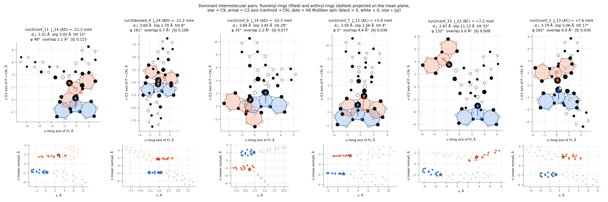
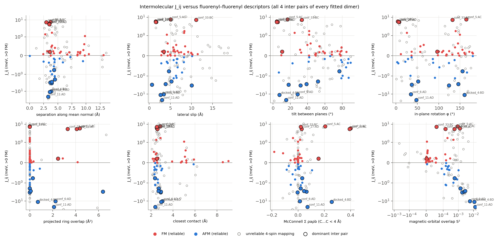
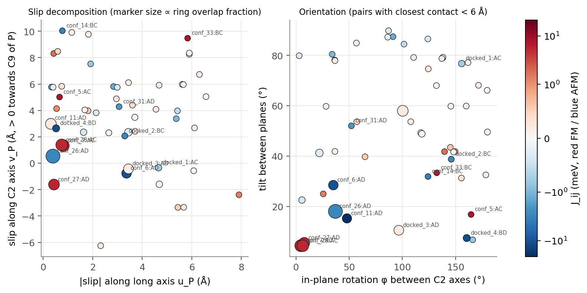
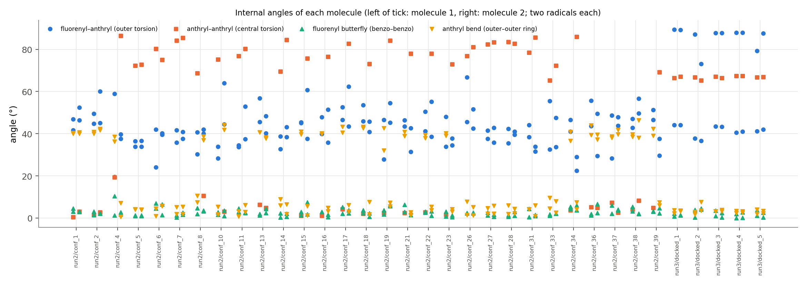

# Fragment overlap and magnetic-orbital overlap of the dimer radicals

Script: `visualisation/analyze_dimer_overlap.py`. Data: [fragment_pairs.csv](fragment_pairs.csv) (one row per dimer × radical pair, all descriptors), [internal_angles.csv](internal_angles.csv), [fragment_spins.csv](fragment_spins.csv) (Mulliken spin of every unit, every finished BS configuration). Reliable dimers = fitted, four stable moments and jackknife |ΔJ|/max|J| ≤ 0.25 (as in [../families/dimer_families.md](../families/dimer_families.md)); 14 dimers, 56 intermolecular pairs. J convention: H = −Σ J S·S, J > 0 FM.

## Main results

1. **The magnetic-orbital overlap S² is the only descriptor that follows the sign and size of the AFM coupling.** Over the AFM pairs, J ≈ -1348 meV × S² (Spearman ρ = -0.78). The strongest AFM contacts have S² = 0.0014–0.0132 (|S| up to 0.115). FM pairs with J > 2 meV have S² ≤ 0.0013: their magnetic orbitals are nearly orthogonal. The FM and AFM ranges touch at about 0.0013–0.0014, so S² does not separate the sign perfectly on its own.
2. **Geometry sets the magnitude of J, not its sign.** The number of C…C contacts, the C9–C9 distance and the separation correlate with |J| but not with J (table below). Close contact is necessary for a sizable J of either sign; the sign is decided by the orbital overlap.
3. **The S01 FM motif (conf_7/27/28) is a near-eclipsed, parallel stack with nearly orthogonal magnetic orbitals.** Tilt 4–6°, φ 5–8° (C9 pointing the same way), separation 3.50–3.52 Å and slip 1.6–1.7 Å, mostly along the C2 axis. The projected ring overlap is the largest of all reliable pairs (3.3–4.4 Ų), yet S² is only 0.0001–0.0013. This is the Kahn picture of FM coupling: the magnetic orbitals overlap in space but their positive and negative overlap regions cancel. A large π overlap area alone does not imply AFM coupling. The cube integrals confirm this directly (section *Signed vs geometric overlap*). In S01, ∫|ψ_aψ_b| = 0.08–0.10 is as large as in AFM pairs, but 62–74% of it cancels by sign.
4. **The strong AFM contacts are rotated or slipped stacks.** conf_11 AD (φ ≈ 48°), conf_6 AD (φ ≈ 35°) and run3/docked_4 BD (φ ≈ 161°, head-to-tail) all have separations of 3.3–3.8 Å, slips of 2.7–3.5 Å and a much larger S. Two strong FM pairs have no fluorenyl–fluorenyl ring overlap. conf_5 AC is head-to-tail (φ ≈ 165°) with a 5 Å slip along the C2 axis, which brings the two C9 to 3.98 Å. conf_33 BC (C9–C9 8.6 Å) and the AFM pair conf_14 BC (slip 10 Å) interact through anthryl contacts, which fluorenyl-plane descriptors cannot represent.
5. **The HS McConnell-I sum does not predict the sign** (ρ ≈ 0 with J). S01 has the largest positive sum (same-sign spin contacts, McConnell predicts AFM) but is FM. Mulliken spin products on contact atoms are not a reliable sign descriptor here.
6. **Internal geometry falls into two classes.** In every low-energy, reliable dimer the bianthryl link is twisted (θ_an–an ≈ 65–86°), the anthryls are nearly flat (bend ≤ 11°) and |J_intra| ≤ 5.2 meV (≤ 8 meV for all twisted-link molecules). In every dimer with a planarised link (θ_an–an < 30°), both anthracenes fold by about 40° (RMS 0.4 Å). These dimers have J_intra ≈ −330 to −530 meV, lie > 1.7 eV above the minimum and all fail the four-spin mapping.
7. **The sign of the orbital overlap, not its extent, separates FM from AFM.** For the dominant pairs, the cancellation fraction 1 − |∫ψ_aψ_b| / ∫|ψ_aψ_b| correlates with J at ρ = +0.89 (p = 1e-06) (clean rows). The projected ring area does not: ρ = -0.19 (p = 0.5). FM pairs cancel 48–80% of their overlap and AFM pairs 15–50%.

## Descriptor ranking (reliable intermolecular pairs)

| descriptor | ρ(J) | p | ρ(abs J) | p |
|---|---|---|---|---|
| S² (magnetic-orbital overlap) | -0.45 | 0.00053 | +0.69 | 4.6e-09 |
| n C…C < 4 Å | -0.04 | 0.76 | +0.72 | 5.7e-10 |
| C9–C9 distance | +0.17 | 0.22 | -0.63 | 2.3e-07 |
| separation along mean normal | +0.02 | 0.87 | -0.46 | 0.00039 |
| C9 lateral offset | +0.00 | 1 | -0.39 | 0.0027 |
| tilt | -0.18 | 0.18 | -0.38 | 0.0038 |
| lateral slip | +0.08 | 0.54 | -0.33 | 0.014 |
| projected ring overlap | -0.11 | 0.4 | +0.24 | 0.069 |
| in-plane rotation φ | +0.06 | 0.64 | -0.16 | 0.23 |
| McConnell Σρaρb | -0.03 | 0.83 | +0.41 | 0.0017 |
| closest contact | +0.01 | 0.92 | -0.13 | 0.33 |

Spearman rank correlations, so the numbers are insensitive to outliers and units.

## Dominant intermolecular pair of every reliable dimer

| dimer | pair | J (meV) | S² | abs S | d⊥ (Å) | slip (Å) | slip v (Å) | slip u (Å) | tilt (°) | φ (°) | overlap (Ų) | C9–C9 (Å) | contact (Å) | contact atoms | n C…C<4 | McConnell |
|---|---|---|---|---|---|---|---|---|---|---|---|---|---|---|---|---|
| run2/conf_11 | AD | -21.24 | 0.0132 | 0.115 | 3.31 | 3.05 | +3.04 | 0.31 | 15 | 48 | 2.1 | 4.59 | 2.40 | H80(H)-H157(H) | 43 | +0.072 |
| run3/docked_4 | BD | -11.15 | 0.0116 | 0.108 | 3.60 | 2.70 | +2.64 | 0.52 | 8 | 161 | 0.7 | 3.67 | 2.93 | H70(H)-C139(fl) | 43 | +0.257 |
| run2/conf_6 | AD | -10.30 | 0.0059 | 0.077 | 3.84 | 3.45 | -0.77 | 3.37 | 29 | 35 | 2.2 | 5.20 | 3.04 | H63(H)-C135(fl) | 23 | +0.014 |
| run2/conf_14 | BC | -3.37 | 0.0018 | 0.043 | 3.93 | 10.07 | +10.04 | 0.78 | 32 | 124 | 0.0 | 8.48 | 2.89 | C13(an)-H166(H) | 29 | -0.003 |
| run2/conf_26 | AD | -3.07 | 0.0025 | 0.050 | 3.67 | 0.67 | +0.54 | 0.40 | 18 | 37 | 6.4 | 4.29 | 2.90 | H80(H)-H147(H) | 29 | +0.065 |
| run3/docked_2 | BC | -2.83 | 0.0029 | 0.054 | 3.94 | 3.89 | +2.07 | 3.30 | 39 | 146 | 0.1 | 4.83 | 2.69 | C48(fl)-H166(H) | 29 | +0.046 |
| run2/conf_31 | AD | -2.03 | 0.0014 | 0.037 | 4.50 | 5.27 | +4.29 | 3.07 | 52 | 52 | 0.0 | 7.16 | 2.71 | C39(fl)-H140(H) | 8 | +0.020 |
| run3/docked_1 | AC | -0.77 | 0.0006 | 0.024 | 4.36 | 4.67 | -0.34 | 4.66 | 77 | 156 | 0.3 | 7.53 | 2.37 | H78(H)-H151(H) | 8 | +0.032 |
| run3/docked_3 | AD | +0.20 | 0.0000 | 0.002 | 3.58 | 3.47 | -0.43 | 3.44 | 11 | 97 | 2.5 | 4.79 | 2.54 | H80(H)-H156(H) | 35 | +0.156 |
| run2/conf_28 | AC | +5.45 | 0.0006 | 0.024 | 3.51 | 1.58 | +1.39 | 0.75 | 4 | 6 | 4.1 | 3.98 | 2.59 | H80(H)-H148(H) | 58 | +0.393 |
| run2/conf_27 | AD | +5.47 | 0.0001 | 0.012 | 3.52 | 1.67 | -1.62 | 0.44 | 6 | 8 | 3.3 | 4.07 | 2.60 | C33(fl)-H156(H) | 53 | +0.028 |
| run2/conf_7 | AC | +5.91 | 0.0013 | 0.036 | 3.50 | 1.56 | +1.33 | 0.81 | 4 | 5 | 4.4 | 3.96 | 2.54 | H80(H)-H148(H) | 60 | +0.401 |
| run2/conf_33 | BC | +7.19 | 0.0001 | 0.008 | 2.97 | 11.13 | +9.48 | 5.83 | 33 | 132 | 0.0 | 8.63 | 2.55 | H71(H)-H168(H) | 38 | +0.021 |
| run2/conf_5 | AC | +7.60 | 0.0009 | 0.030 | 3.74 | 5.06 | +5.02 | 0.66 | 17 | 165 | 0.0 | 3.98 | 2.85 | H80(H)-H165(H) | 36 | +0.207 |

slip v > 0: centroid of the second fragment displaced towards the C9 of the first. φ = 0: both C2 axes point the same way; 180°: head-to-tail. contact atoms: index (0-based, ORCA) and unit (fl = fluorenyl, an = anthryl, C9 = radical carbon, H).

Face view on the mean plane (frame of the first fragment) and edge view, for the three strongest AFM and three strongest FM dominant pairs (automatic selection).

## Definitions

**Fragments.** Each radical half (A, B on molecule 1; C, D on molecule 2) is read from `radical_fragments.json`, the same atoms used for FlipSpin and the J fit. It consists of a 13-C fluorenyl (5-ring with the radical carbon C9 plus two benzo rings) bonded through C9 to a 14-C anthracene-type unit (three linearly fused rings). The two anthryls are joined by the central bond. The units are defined in the reference numbering (`REF_UNITS`) and mapped by graph isomorphism. Pair descriptors use `PLANE_UNIT = "fluorenyl"`; `half_carbons`, `anthryl` or `custom` (`CUSTOM_REF_UNITS`) are alternatives. The fluorenyl is the natural radical fragment: in uuuu it carries 89% of the half's spin (range 86%–105%), with 0.55 on C9 alone.

**Planes and distances.** Each plane is an SVD best-plane fit, and planarity is the RMS out-of-plane distance of the unit (fluorenyl ≤ 0.1 Å everywhere). The plane normals are aligned and averaged into n̄. Separation d⊥ is the centroid difference projected on n̄. Slip is the remaining in-plane part. Tilt is the angle between the normals.

**In-plane rotation.** Parallel planes do not fix the overlap: two parallel fluorenyls can still be rotated or slipped, which changes the SOMO overlap and can flip the sign of J. The in-plane frame is built from atom coordinates only. v is the projection of (C9 − fluorenyl centroid) on the mean plane, which is the C2 axis of fluorenyl and a polar direction. u = n̄ × v is the long axis; its sign is undefined because the two benzo rings are equivalent, so only |slip_u| is reported. φ is the angle between v_P and v_Q (0–180°), and χ_long = min(φ, 180° − φ) is the long-axis crossing angle. Above about 30° tilt, φ and the slip split are only indicative.

**Overlap area.** The three ring polygons of each fluorenyl are projected on the mean plane and the area of their intersection is rasterised (step 0.05 Å). This is a geometric π-stacking measure that does not use orbital phases.

**McConnell-I sum.** Σ ρa ρb over the C…C pairs closer than 4.0 Å between the two halves, with HS (uuuu) Mulliken spin populations. In McConnell's model, a positive sum (contacts of same-sign spin density) favours AFM coupling and a negative sum favours FM coupling.

## Spin and density information: what the ORCA outputs provide

Available per BS configuration: `.out` (Mulliken and Löwdin atomic spin populations, UNO occupation numbers, UCO overlaps), `.gbw`, `.uno`, `.uco`, `.qro`, `.property.txt` and `.densitiesinfo`. Most `.densities` files have been deleted. There are no `.cube` files for the dimers (the 36 cubes in the repository belong to the monomer `angle_scans/natural_orbitals` analysis).

1. **Integrated spin on the fragments (implemented).** Mulliken spins are summed over fluorenyl, anthryl and H of every half for every finished configuration ([fragment_spins.csv](fragment_spins.csv)). This is reliable and cheap, but it only measures how much spin each unit carries, not how strongly two units interact.
2. **Magnetic-orbital overlap S_ij (implemented; the main density-based descriptor).** With UCO on, ORCA prints the overlaps T of the corresponding α/β orbital pairs. In a BS state with k flipped radicals, the k smallest T are the overlaps between the β magnetic orbitals of the flipped radicals and the α magnetic orbitals of the others. The list has N_β + 1 entries; the last one is an unmatched α orbital printed as 0. A fixed cutoff would fail because polarised core pairs can reach 0.87 when the coupling is strong. With x_ij = S_ij²: a single flip of i gives T_i² = Σ_j x_ij, and a pair flip (ij | kl) gives T₁² + T₂² = x_ik + x_il + x_jk + x_jl. The 7 BS states therefore give 7 linear equations for the 6 S_ij², with one redundant closure check. The largest closure residual among the reliable dimers is 1.7e-05, against S² ≈ 10⁻³. Physical meaning: S_ij = ⟨a_i|b_j⟩ is the overlap between the magnetic orbitals of radicals i and j. The integrand a_i(r) b_j(r) vanishes except where both orbitals are non-zero, i.e. in the intermolecular contact region, so S_ij is exactly the contact overlap of the SOMOs. In the Kahn / Hay–Thibeault–Hoffmann picture, J = J_F + J_AF with J_AF ∝ −S² (kinetic, antiferromagnetic) and J_F > 0 from the exchange integral of the overlap density. Limitations: only |S| is recovered (the sign is lost), the magnetic orbitals are assumed transferable between configurations (the same assumption as the Ising fit), and only configurations with `used_in_fit` enter.
3. **Cube-based measures (signed overlap implemented, see *Signed vs geometric overlap*; the text below is the original proposal).** `orca_plot` 6.1.1 runs locally. For a BS `.gbw` it lists the SCF electron and spin densities as available (stored in the `.gbw`), and it can plot any MO, UNO or UCO. A 40³ spin-density cube of one dimer takes about 40 s. The physically motivated next step would target J_F, the ferromagnetic part that S² misses and that matters for S01: plot the two magnetic corresponding orbitals of a pair (cleanest from the single-flip states, where the β magnetic orbital is localised on one radical) and integrate the overlap density ρ_ab = a·b. ∫ρ_ab reproduces S, as a check; ∫ρ_ab² (or ∫|ρ_ab|) measures how much the orbitals coexist in space and is the usual proxy for the exchange integral K_ab, which drives FM coupling when S ≈ 0. A large ∫ρ_ab² with small |S| would confirm the accidental-orthogonality explanation of S01. A simple spin-density overlap (∫ρ_s,A ρ_s,B) is not proposed: it has no direct link to J and it repeats the McConnell sum, which already fails here.

## Internal angles of the molecules

Per radical half: θ_fl–an = angle between the fluorenyl and anthryl planes (outer torsion); fluorenyl butterfly = angle between its two benzo rings; anthryl bend = angle between its two outer rings. Per molecule: θ_an–an (central torsion) and θ_fl–fl (end-to-end). These are whole-unit SVD planes, so the values differ by a few degrees from the ring-to-ring angles in the families report. In run3 the A/C outer torsion is about 88° because those relaxations had constrained torsions.

| class | molecules | in reliable dimers | median θ_an–an (°) | median θ_fl–an (°) | median anthryl bend (°) | median anthryl RMS (Å) | J_intra min (meV) | J_intra max (meV) | lowest ΔE_geom (meV) |
|---|---|---|---|---|---|---|---|---|---|
| planarised link | 25 | 0 | 3 | 45 | 41 | 0.41 | -529 | -332.4 | 1743 |
| twisted link | 43 | 28 | 76 | 41 | 5 | 0.05 | -8 | +1.0 | 0 |

## Signed vs geometric overlap of the magnetic orbitals (cube-based)

Scripts: `visualisation/dimer_overlap/overlap_table.py` (calls `magnetic_orbitals.py`). Data: [../dimer_overlap/overlap_sign_table.csv](../dimer_overlap/overlap_sign_table.csv). This section was added by hand and is not written by `analyze_dimer_overlap.py`; rerunning that script overwrites it.

**Method.** For the dominant intermolecular pair (a, b) of every dimer, the two magnetic orbitals are the α/β UHF corresponding orbitals of the BS state uudd (computed as dduu). In that state molecule 2 is flipped as a whole, so every magnetic UCO pair is intermolecular. Of the two magnetic pairs, the one whose orbitals sit on a and b is kept. Single-flip states are not used: there, the β orbital of b pairs with the α orbital it overlaps most, which is the *intra*molecular partner whenever the intermolecular overlap is small. Both orbitals are written as cubes with `orca_plot` (100³ grid), and three quantities are integrated:
- the net signed overlap |S| = |∫ψ_aψ_b|, which reproduces the ORCA UCO overlap to 10⁻⁴ for every dimer;
- the coexistence ∫|ψ_aψ_b|, i.e. how much the two orbitals occupy the same space regardless of sign;
- the cancellation 1 − |S| / ∫|ψ_aψ_b|. It is 0 when all overlap regions have the same sign and 1 when the positive and negative regions cancel completely.

The ring overlap area is the purely geometric descriptor defined above. A row is *clean* when both orbitals have ≥ 70% of |ψ|² on their own radical half. In the other rows an orbital is shared with another radical: in conf_1, 13, 36, 37 and 38, |S| ≈ 0.3–0.4 with one orbital < 20% on its own half. These are not a-b overlaps.

**Result.**
- **Geometric overlap does not decide the sign.** The FM S01 pairs (conf_7/27/28) and the AFM conf_26 pair all have large ring overlaps (3.3–6.4 Ų).
- **Coexistence is also similar.** The two orbitals coexist about as much in S01 (∫|ψψ| = 0.08–0.10) as in AFM pairs (0.05–0.18).
- **The sign-weighted overlap separates them.** In S01, about two thirds of the overlap cancels (cancellation 0.62–0.74) and the net |S| is 0.02–0.04. In the strong AFM contacts (conf_11, conf_6, run3/docked_4, conf_19, conf_21), the overlap regions mostly share one sign (cancellation 0.15–0.24) and |S| = 0.08–0.15.
- **Separation of the two signs.** Over the clean rows, the FM range (0.48–0.80) and the AFM range (0.15–0.50) touch only at about 0.5: conf_4 (FM, unreliable) at 0.48 and conf_26 (AFM, weak, −3 meV) at 0.50. Over the reliable and clean rows they are separated (FM 0.62–0.67, AFM 0.18–0.50).

This is the Kahn accidental-orthogonality picture of the FM coupling, now shown directly rather than inferred from S² and the ring area.

| descriptor | ρ with J, clean (17) | ρ with J, reliable & clean (10) |
|---|---|---|
| projected ring overlap (geometric) | -0.19 (p = 0.5) | -0.16 (p = 0.7) |
| ∫\|ψ_aψ_b\| (orbital coexistence) | -0.63 (p = 0.006) | -0.66 (p = 0.04) |
| \|S\| (net signed overlap) | -0.86 (p = 1e-05) | -0.84 (p = 0.002) |
| cancellation | +0.89 (p = 1e-06) | +0.87 (p = 0.001) |

Clean rows:

| dimer | pair | J (meV) | reliable | ring overlap (Ų) | |S| = \|∫ψ_aψ_b\| | ∫\|ψ_aψ_b\| | cancellation | on own a / b |
|---|---|---|---|---|---|---|---|---|
| run2/conf_21 | AC | -28.66 | no | 2.94 | 0.142 | 0.170 | 0.16 | 0.83 / 0.96 |
| run2/conf_19 | AC | -23.66 | no | 5.90 | 0.154 | 0.181 | 0.15 | 0.84 / 0.72 |
| run2/conf_11 | AD | -21.24 | yes | 2.11 | 0.116 | 0.146 | 0.21 | 0.97 / 0.97 |
| run3/docked_4 | BD | -11.15 | yes | 0.71 | 0.108 | 0.131 | 0.18 | 0.97 / 0.97 |
| run2/conf_34 | AC | -11.12 | no | 0.00 | 0.075 | 0.112 | 0.33 | 0.79 / 0.82 |
| run2/conf_6 | AD | -10.30 | yes | 2.25 | 0.082 | 0.108 | 0.24 | 0.98 / 0.85 |
| run2/conf_22 | AC | -4.69 | no | 0.00 | 0.051 | 0.084 | 0.39 | 0.85 / 0.95 |
| run2/conf_26 | AD | -3.07 | yes | 6.39 | 0.052 | 0.104 | 0.50 | 0.98 / 0.90 |
| run3/docked_2 | BC | -2.83 | yes | 0.08 | 0.056 | 0.085 | 0.34 | 0.98 / 0.89 |
| run2/conf_31 | AD | -2.03 | yes | 0.00 | 0.038 | 0.054 | 0.30 | 0.98 / 0.98 |
| run3/docked_1 | AC | -0.77 | yes | 0.27 | 0.026 | 0.049 | 0.46 | 0.89 / 0.80 |
| run2/conf_4 | AC | +1.86 | no | 0.00 | 0.049 | 0.094 | 0.48 | 0.71 / 0.98 |
| run2/conf_39 | AC | +2.61 | no | 6.67 | 0.018 | 0.090 | 0.80 | 0.70 / 0.97 |
| run2/conf_28 | AC | +5.45 | yes | 4.10 | 0.031 | 0.093 | 0.67 | 0.81 / 0.78 |
| run2/conf_7 | AC | +5.91 | yes | 4.37 | 0.040 | 0.104 | 0.62 | 0.89 / 0.89 |
| run2/conf_5 | AC | +7.60 | yes | 0.00 | 0.032 | 0.088 | 0.64 | 0.94 / 0.95 |
| run2/conf_15 | AC | +10.73 | no | 0.00 | 0.041 | 0.098 | 0.58 | 0.95 / 0.95 |

Not clean (orbital shared with another radical; not a clean a-b overlap):

| dimer | pair | J (meV) | reliable | ring overlap (Ų) | |S| = \|∫ψ_aψ_b\| | ∫\|ψ_aψ_b\| | cancellation | on own a / b |
|---|---|---|---|---|---|---|---|---|
| run2/conf_1 | AD | -7.12 | no | 0.00 | 0.410 | 0.462 | 0.11 | 0.69 / 0.11 |
| run2/conf_13 | AD | -6.88 | no | 0.00 | 0.404 | 0.457 | 0.12 | 0.10 / 0.66 |
| run2/conf_10 | AC | -3.94 | no | 0.00 | 0.061 | 0.090 | 0.33 | 0.97 / 0.69 |
| run2/conf_14 | BC | -3.37 | yes | 0.00 | 0.054 | 0.085 | 0.37 | 0.97 / 0.65 |
| run2/conf_37 | AD | -1.90 | no | 0.00 | 0.407 | 0.456 | 0.11 | 0.62 / 0.18 |
| run3/docked_3 | AD | +0.20 | yes | 2.47 | 0.003 | 0.047 | 0.93 | 0.85 / 0.34 |
| run2/conf_23 | AC | +1.25 | no | 0.00 | 0.013 | 0.033 | 0.60 | 0.72 / 0.22 |
| run2/conf_16 | AD | +3.94 | no | 0.00 | 0.038 | 0.059 | 0.35 | 0.78 / 0.20 |
| run2/conf_38 | BD | +3.98 | no | 0.00 | 0.302 | 0.372 | 0.19 | 0.07 / 0.75 |
| run2/conf_36 | AD | +4.10 | no | 0.00 | 0.348 | 0.410 | 0.15 | 0.70 / 0.03 |
| run2/conf_27 | AD | +5.47 | yes | 3.31 | 0.021 | 0.082 | 0.74 | 0.54 / 0.84 |
| run2/conf_33 | BC | +7.19 | yes | 0.00 | 0.023 | 0.049 | 0.52 | 0.19 / 0.97 |

## Caveats

- 14 reliable dimers with 56 intermolecular pairs, and only 5–7 strong pairs of each sign: the trends are robust in rank but thresholds are not.
- S² relies on the ORCA UCO list and on transferable magnetic orbitals; for the unreliable dimers (pattern-failed configurations removed) it is often underdetermined or noisy.
- Cube-based overlaps: 12 of 29 dimers are not clean (a magnetic orbital is shared with another radical in the uudd state). The FM/AFM cancellation ranges touch at about 0.5. The sign of ∫ψ_aψ_b is arbitrary (orbital phases), so only |S| is reported.
- Mulliken spins (fragment spins, McConnell) depend on the basis; Löwdin spins are in the same outputs if a cross-check is needed.
- Fluorenyl-plane descriptors miss couplings through anthryl contacts (conf_5 AC, conf_33 BC); set `PLANE_UNIT = "half_carbons"` to describe the whole halves.
